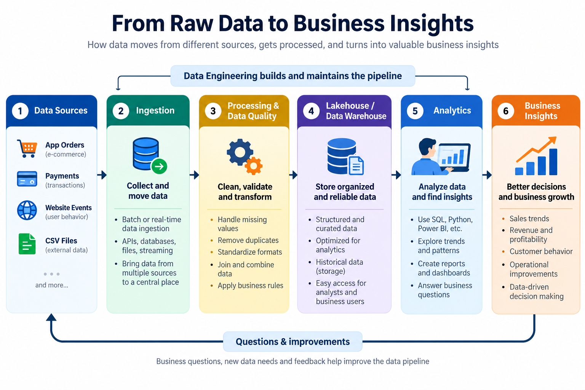

# Behind Every Insight, There Is Data Engineering
## A beginner-friendly guide to how raw data becomes business value

### Introduction: What happens before a dashboard tells a story?

Imagine ordering food through an app. Within seconds, the platform records the order, payment, restaurant, delivery partner, location, and delivery time. Multiply that by thousands or millions of orders, and a business quickly has a huge amount of data.

But raw data does not automatically become useful information. Records may arrive from different systems, use different formats, contain duplicates, or have missing values. Before a company can confidently answer questions such as “Which city generates the most revenue?” or “Why did sales decline last month?”, its data needs to be collected, processed, organized, and made accessible.

That is where **Data Engineering** comes in. Data Engineering builds and maintains the systems that move data from its sources to reliable, usable destinations. In this article, we will explore the foundations of Data Engineering, compare the work of Data Engineers and Data Analysts, and understand three important Databricks concepts: Workspace, Compute, and Notebooks.

## 1. What is Data Engineering?

In simple terms, Data Engineering is the practice of designing and maintaining systems that collect, process, validate, store, and deliver data for analytics and other uses.

Data can come from many places: application databases, websites, mobile apps, payment systems, APIs, CSV files, sensors, and event streams. A Data Engineer builds workflows—often called **data pipelines**—to bring this information together and make it dependable.

Think of a data pipeline like a factory production line:

- **Collect:** Bring raw materials (data) from different sources.
- **Inspect:** Check whether the incoming data is valid and complete.
- **Process:** Clean, standardize, combine, or enrich the data.
- **Store:** Put the prepared data somewhere suitable for its intended use.
- **Deliver:** Make it available to analysts, dashboards, applications, or machine-learning systems.

### A real-world example: an online shopping company

When a customer places an order, the company may record the order details in an operational database. Payment information may live in a separate system, while website activity is collected as events. A data pipeline can ingest the relevant records, standardize timestamps and product identifiers, identify duplicate events, apply quality checks, and write curated data to an analytical platform.

An analyst can then use SQL or a BI tool to compare sales by product, region, or month. The business can use those findings to make better decisions.

### ETL and ELT: two common data workflows

**ETL** means Extract, Transform, Load:
1. Extract data from its source.
2. Transform it—for example, standardize formats or validate records.
3. Load the processed data into its destination.

**ELT** means Extract, Load, Transform. Data is loaded into the target platform first and transformed there. The right approach depends on the architecture, data, governance needs, and processing platform.

## 2. Why do businesses need Data Engineering?

Imagine a retailer combining sales files from several branches. One branch uses `27-10-2026` for dates, another uses `2026/10/27`, and a third accidentally exports some transactions twice. Some records have missing product IDs. If the company reports totals without checking these issues, its dashboard may show misleading results.

Poorly managed data can cause:
- **Incorrect reporting:** Duplicates can inflate sales; missing records can hide activity.
- **Slow analysis:** Analysts spend too much time manually combining and cleaning files.
- **Conflicting metrics:** Teams may calculate the same business measure in different ways.
- **Operational problems:** Broken or delayed pipelines can leave dashboards out of date.
- **Poor decisions:** Managers may act on incomplete or inaccurate information.

Data Engineering helps address these risks through validation rules, consistent transformations, monitoring, documentation, access controls, and automated workflows. It does not guarantee that every dataset is perfect, but it creates repeatable processes for detecting and managing data issues.

A reliable pipeline also helps teams work at scale. As data grows, the company can adapt its architecture and compute resources rather than relying entirely on manual spreadsheet work.

## 3. Data Engineer vs. Data Analyst

Consider a retail company asking: **“Why did our sales decline this month?”** Both roles contribute, but they focus on different parts of the problem.

A **Data Engineer** builds and maintains the data systems: collecting records from source systems, transforming them, checking quality, organizing storage, and monitoring pipeline reliability.

A **Data Analyst** uses prepared data to investigate the question: writing SQL queries, exploring patterns, comparing product and regional performance, creating dashboards, and communicating findings to stakeholders.

| Category | Data Engineer | Data Analyst |
|---|---|---|
| Main responsibility | Build and maintain data pipelines and data platforms | Analyze data and communicate business findings |
| Main objective | Make data reliable, organized, and accessible | Turn data into insights that support decisions |
| Typical tasks | Ingestion, transformation, orchestration, quality checks, monitoring | SQL analysis, exploratory analysis, KPI tracking, reporting |
| Common tools | SQL, Python, Apache Spark, Databricks, cloud storage and orchestration tools | SQL, Excel, Power BI, Python, visualization tools |
| Typical outputs | Pipelines, curated tables, data models, quality checks | Reports, dashboards, analysis, recommendations |
| Business contribution | Creates dependable data foundations | Helps explain performance and identify opportunities |

The responsibilities can overlap. Analysts may build data preparation workflows, and engineers may investigate data patterns while troubleshooting pipelines. The key difference is the primary outcome each role is accountable for.

## 4. OLTP vs. OLAP

Businesses use different systems for processing day-to-day transactions and analyzing broader trends.

**OLTP (Online Transaction Processing)** supports operational activities such as placing an order, recording a payment, or updating inventory. It is designed to handle many individual transactions accurately and efficiently.

**OLAP (Online Analytical Processing)** supports analysis across larger volumes of historical or combined data. It helps answer questions such as “How did revenue this quarter compare with last year?” or “Which product category has the highest margin?”

| Feature | OLTP | OLAP |
|---|---|---|
| Main purpose | Run day-to-day transactions | Analyze business performance |
| Typical activity | Insert or update an individual order or payment | Aggregate and compare many orders or payments |
| Data focus | Current operational records | Historical and combined data for analysis |
| Typical users | Applications and operational teams | Analysts, managers, and decision-makers |
| Example question | “Was this payment recorded?” | “How did payment volume change by month?” |

A typical architecture may collect transactions in an OLTP database, move relevant data through pipelines, and prepare it for an analytical platform. The systems are complementary: OLTP helps run the business, while OLAP helps understand it.

## 5. Getting started with Databricks

Databricks is a platform for working with data, building data pipelines, analytics, and AI applications. It provides an environment where teams can use tools such as SQL and Python to process and explore data. Apache Spark is one of the technologies used for distributed data processing in Databricks.

Three foundational concepts are Workspace, Compute, and Notebooks.

### A. Databricks Workspace

A **Workspace** is an environment where a team accesses and organizes its Databricks work. Depending on the setup and permissions, it can include notebooks, queries, files, folders, jobs, and other resources.

Think of it as a shared digital workshop. Team members can organize their work, collaborate, and access resources according to the permissions configured for them.

### B. Compute

**Compute** means the processing resources used to execute work. Writing a Python or SQL statement is not the same as running it: execution requires an available compute environment.

Imagine writing a recipe. The notebook contains the instructions, but you still need a kitchen and equipment to prepare the food. Similarly, code needs compute resources to run and produce results. Databricks offers different compute options depending on the workload and configuration.

### C. Notebooks

A **Databricks Notebook** is an interactive place to write and execute code, inspect results, and document the steps of an analysis. Notebooks can support languages such as Python and SQL, subject to the notebook and environment configuration.

A notebook is divided into cells. One cell might contain an explanation in Markdown, another might load data, and another might calculate revenue or display a chart. Running cells step by step makes it easier to experiment, debug, and understand how results are produced.

For example, a Python cell could calculate total sales from a small list:

```python
sales = [1000, 2000, 3000]
total_sales = sum(sales)
print(total_sales)
```

Output:

```text
6000
```

For a larger dataset, a Data Engineer might use Spark DataFrames or SQL in a notebook to load, transform, and validate records at scale.

| Databricks concept | Simple meaning | Example |
|---|---|---|
| Workspace | Where work and resources are organized | A team's data engineering project area |
| Compute | Resources that execute code | Running a transformation on a dataset |
| Notebook | An interactive document for code, explanations, and results | Loading sales data, cleaning it, and checking totals |

## 6. From raw data to business insight

The following diagram summarizes the journey. The pipeline can be scheduled or event-driven, and the exact steps vary by business. Quality checks and monitoring help teams identify problems before unreliable data affects downstream analysis.



1. **Data sources:** Applications, payments, website events, databases, and files generate data.
2. **Ingestion:** Pipelines collect or receive the data.
3. **Processing and quality:** Transformations standardize fields, validate records, and handle issues.
4. **Analytical storage:** Curated data is stored in a warehouse, lakehouse, or another suitable system.
5. **Analytics:** Analysts query the data and build reports or dashboards.
6. **Business insights:** Teams use the findings to make decisions and improve operations.

## 7. How the roles and tools work together

Return to the retailer whose sales have declined. The Data Engineer ensures that order and product data are collected and prepared consistently. Databricks may provide the workspace and compute environment for processing. The Data Analyst queries the prepared tables, compares sales across time and regions, and builds a dashboard. Management uses the findings to investigate stock availability, pricing, marketing, or other possible causes.

The technology alone does not make a decision. Reliable data, thoughtful analysis, business context, and clear communication all matter.

## 8. My key learning

What stands out to me is that a dashboard is only as trustworthy as the data behind it. Before a KPI appears in a report, data may need to travel through several systems and quality checks. Data Engineering creates that foundation, while Data Analytics helps translate the prepared data into answers to business questions.

As someone developing skills in SQL, Python, Excel, and Power BI, understanding this connection helps me see where analytical work fits into the wider data lifecycle. Learning Databricks is a useful next step because it introduces an environment where data processing and analytics workflows can be developed together.

## Conclusion

Data Engineering is an essential part of turning growing volumes of raw data into dependable information. Data pipelines collect, process, validate, and deliver data; analytical systems make it available for investigation; and Data Analysts use it to explain performance and support decisions.

Understanding the difference between OLTP and OLAP, and learning the basics of Databricks Workspace, Compute, and Notebooks, provides a strong starting point for exploring modern data platforms. Behind every useful insight is a process that helps make the underlying data reliable.

## References and further learning

1. [Databricks documentation](https://www.databricks.com/databricks-documentation) — Official documentation for Databricks concepts and features.
2. [Databricks: Compute](https://docs.databricks.com/aws/en/compute) — Overview of compute options.
3. [Databricks: Create a workspace](https://docs.databricks.com/aws/en/admin/workspace) — Workspace concepts and management.
4. [Apache Spark SQL](https://spark.apache.org/sql/) — Official overview of structured data processing with Spark SQL.
5. [Microsoft Learn: Online Transaction Processing (OLTP)](https://learn.microsoft.com/en-us/azure/architecture/data-guide/relational-data/online-transaction-processing) — Explanation of transactional systems.
6. [Microsoft Support: Overview of OLAP](https://support.microsoft.com/en-us/excel/overview-of-online-analytical-processing-olap) — Overview of analytical processing and business intelligence.

*Note: The diagram included with this article is an original, assignment-specific visual created to explain the data pipeline. Review the article, verify the references, and adjust the personal reflection so it accurately represents your own learning before publishing.*
